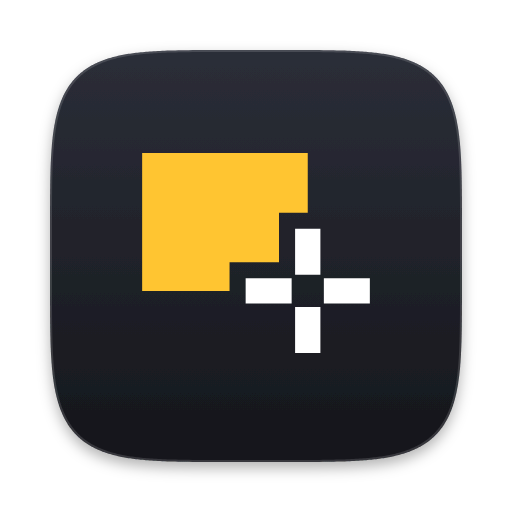

<p align="center">
  
</p>

# Snap

An open-source screenshot tool for macOS, in the spirit of CleanShot X.
It lives in the menu bar, captures with ScreenCaptureKit, and handles multiple displays and
Retina scaling.

> Status: early development. The MVP features below work; expect rough edges.

## Features

- **Capture area, window or fullscreen** from the menu bar or global shortcuts.
- **Area selection** on a frozen image of every display: dimmed overlay, crosshair guides,
  a magnifier with pixel coordinates, live pixel size. While dragging, Shift makes a square,
  Option grows from the center and holding Space moves the selection. Space before dragging
  switches to window capture; Esc or right-click cancels.
- **Window capture**: hover to highlight, click to capture. Keeps the window's rounded corners
  on a transparent background and adds a drop shadow (optional).
- **Capture text (OCR)**: select an area and its text goes to the clipboard, recognized on
  your Mac with the Vision framework (English, Chinese and more; table rows keep their cells
  tab-separated). Also available on any Quick Access preview.
- **Scrolling capture**: select an area, scroll through it (trackpad or wheel, at your own pace),
  click Done, and get one tall image. Fixed headers stay at the top and fixed footers appear
  once at the bottom.
- **Screen recording**: select an area and record it to MP4 (H.264, Retina resolution,
  15/30/60 fps, pointer optional), with sound from the Mac and/or the microphone mixed into one
  track. The menu bar icon becomes a stop button with a timer; pause and resume from its menu
  (pauses leave no gap).
  From its Quick Access preview, trim a recording (QuickTime-style trim bar, no re-encoding) or
  turn it into a looping GIF.
- **Quick Access preview** in the bottom-right corner after each capture: drag it into any app
  as a file, copy, save, share, annotate, pin or close. Closes itself after a few seconds unless hovered.
- **Annotation editor**: arrow, rectangle, ellipse, line, pen, text, highlight, pixelate, blur,
  spotlight (dims everything else) and numbered counters, with colors, three sizes, undo/redo, copy and PNG export at full resolution.
  The select tool moves, restyles and deletes what you've drawn; double-click a text to change
  it. Crop with C. **Background** puts the result on a gradient, solid color or your desktop
  picture, with padding, rounded corners, shadow and an optional 1:1, 4:3 or 16:9 canvas, ready
  to share. Hold Shift for squares and 45° arrows, Option to draw from the center.
- **Existing images**: Open Image… annotates any image file; Annotate / Pin Clipboard Image work
  on whatever image you copied (image data or a copied file).
- **Pins**: keep a capture floating above all windows. Drag to move, scroll or pinch to zoom,
  ⌥-scroll to change opacity, right-click for more.
- **History**: the last 50 captures (configurable) are kept, so a closed preview is never lost.
  Open History… from the menu bar to copy, annotate, pin, drag out or reveal any of them.
- **Settings**: save folder, file name template, after-capture actions, shortcuts.

## Install

Download the latest `Snap-<version>.dmg` from [Releases](https://github.com/szupzj18/snap/releases),
open it and drag Snap into Applications. On first launch Snap walks you through granting
Screen Recording permission.

Builds that aren't notarized by Apple need one extra step the first time: Control-click Snap in
Applications, choose **Open**, then **Open** again. The release notes say when that applies.

Snap checks GitHub for a newer release once a day (a single request to GitHub's public API, no
other data sent) and offers to open the download page. Turn it off in Settings › General.

## Shortcuts

| Action | Default |
| --- | --- |
| Capture area | ⌥⇧4 |
| Capture window | ⌥⇧5 |
| Capture fullscreen (display under the pointer) | ⌥⇧3 |
| Capture text (OCR) | ⌥⇧2 |
| Capture scrolling (press again to finish) | ⌥⇧7 |
| Record screen (press again to stop) | ⌥⇧6 |

All of them can be changed in Settings › Shortcuts. The defaults stay off macOS's own ⌘⇧3/4/5;
to use those for Snap, turn them off first in System Settings › Keyboard ›
Keyboard Shortcuts › Screenshots.

In the editor: V select, C crop, A arrow, R rectangle, O ellipse, L line, D pen, T text,
H highlight, P pixelate, B blur, S spotlight, N counter;
⌘Z / ⇧⌘Z undo and redo; ⌘C copy; ⌘S save; pinch or ⌘= / ⌘- to zoom, ⌘0 to fit, ⌘1 for 100 %,
two-finger scroll to move around when zoomed in. With something selected, Delete removes it and
Esc deselects.

## Requirements

- macOS 14 Sonoma or later
- Xcode 15 or later (Swift 5.9+) to build

## Building

```sh
make app      # builds build/Snap.app
make run      # builds, then (re)launches the app
make test     # runs unit tests
CONFIG=release make app
```

Snap is a plain Swift package; `open Package.swift` works for editing and running tests in
Xcode. Launch the app through `make run` rather than Xcode's Run button: only the bundled `.app`
gets its own Screen Recording permission.

`make test` skips the tests that take real screenshots. Run them with
`SNAP_INTEGRATION=1 make test` from a terminal that has Screen Recording access; one of them
briefly shows a small test window.

### Releasing

```sh
git tag v0.2.0 && git push origin v0.2.0
```

The Release workflow builds `Snap-0.2.0.dmg` and attaches it to a **draft** release; review it on
GitHub and publish. `make dmg` (with `VERSION=...`) does the same packaging locally.

Signing and notarization switch on when the repository has these secrets:

| Secret | What |
| --- | --- |
| `DEVELOPER_ID_P12_BASE64` | Developer ID Application certificate and key, exported as .p12, base64-encoded |
| `DEVELOPER_ID_P12_PASSWORD` | The .p12 export password |
| `NOTARY_KEY_P8_BASE64` | App Store Connect API key (.p8, base64), Developer role |
| `NOTARY_KEY_ID`, `NOTARY_ISSUER_ID` | That key's ID and issuer ID |

Without them the app is ad-hoc signed and the release notes explain the first-launch step.

### UI snapshots

```sh
make ui-snapshots   # writes build/ui-snapshots/*.png
```

Renders the Quick Access cards, area selection (with the magnifier), the editor, its crop mode,
the recording trim window, the history window and Settings, each to a PNG, so UI changes can be reviewed side by side
without clicking through the app. Screen content in them is made up. The windows are placed
far outside every display, so nothing appears on screen, but capturing them needs Screen
Recording access for the terminal. They're skipped in `make test`. The cases live in
`Tests/SnapUISnapshots`; add one there when you change a piece of UI.

### Code signing

macOS remembers the Screen Recording permission per code signature. With the default ad-hoc
signature you have to grant it again after every rebuild. To avoid that, sign with a stable
identity by creating a `local.mk` (gitignored):

```make
SIGN_IDENTITY = Apple Development: Your Name (TEAMID)
```

`security find-identity -v -p codesigning` lists the identities you have.

## Permissions

Snap needs Screen Recording access (System Settings › Privacy & Security ›
Screen & System Audio Recording). On first launch it shows a short guide that opens the right
settings page. macOS sometimes applies a new grant only after a restart of the app; the guide has
a Relaunch button for that. Recent macOS versions also ask now and then to confirm that apps may
keep recording the screen. That prompt comes from the system.

## How it's put together

| Module | What it does |
| --- | --- |
| `SnapCore` | Capture model, coordinate conversion, settings, file names, PNG export, clipboard, window shadow |
| `SnapCapture` | ScreenCaptureKit wrappers: display and window capture, window list, permission |
| `SnapAnnotate` | Annotation model with undo/redo, renderer shared by canvas and export, editor window |
| `Snap` | The menu bar app: shortcuts, overlays, Quick Access, pins, settings, onboarding |

A capture goes through `CaptureCoordinator` (permission check, selection UI, ScreenCaptureKit)
and comes out as a `Capture` value: pixels, pixels-per-point scale, and where it was on screen.
`PostCaptureRouter` then runs the after-capture actions the user has enabled.

Coordinates: AppKit uses a bottom-left origin, Quartz and ScreenCaptureKit a top-left origin,
and each display has its own pixel scale. `ScreenGeometry` holds the conversions between these
spaces and is unit-tested.

## Roadmap

Planned for after the MVP, with the extension points already in place:

- Upload to a storage service. (Sharing through macOS's Share menu — AirDrop, Messages, Mail —
  is already there, from Quick Access, pins and the history.)

## Icon

The app icon, menu bar glyph, colours and usage rules live in [`design/icon`](design/icon/README.md).

## License

MIT, see [LICENSE](LICENSE).
